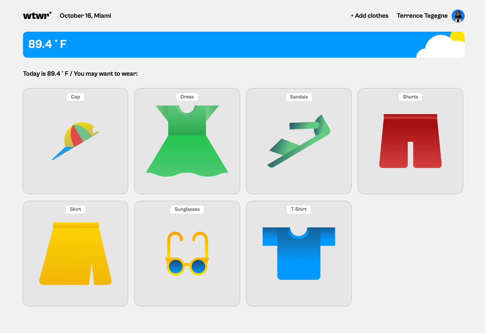
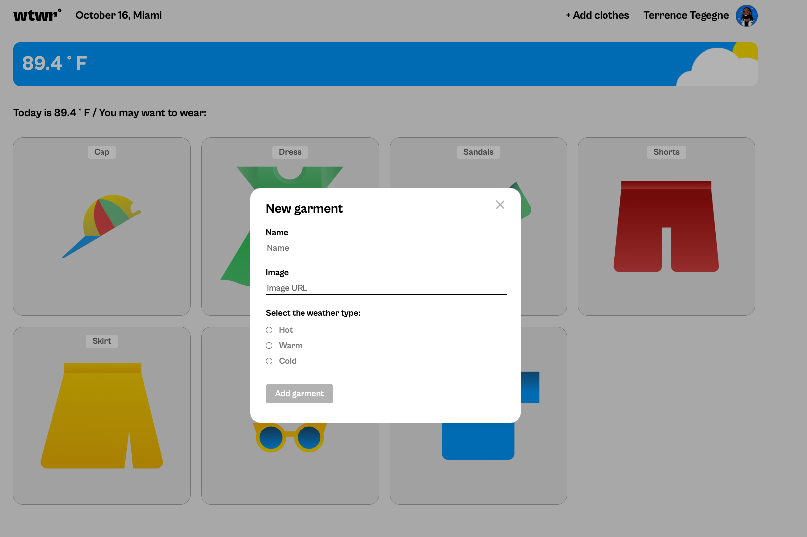

# WTWR (What to Wear?)

## About the project

WTWR is a React app that checks the current weather and suggests clothing for it. It gets live weather data for a set location from the OpenWeather API, sorts the temperature into **hot**, **warm**, or **cold**, and shows only the clothing items that suit that range.





## Features

- **Live weather:** shows the current temperature and city from the OpenWeather API.
- **Weather card:** shows an image matching the current condition (clear, clouds, fog, rain, snow, thunderstorm) and time of day (day or night), with a default image for any other condition.
- **Clothing suggestions:** filters the clothing cards by temperature:
  - Hot: 86°F and above
  - Warm: 66–85°F
  - Cold: below 66°F
- **Item preview modal:** click a clothing card to open a larger image with its name and weather type.
- **Add garment modal:** a form for adding a new clothing item (name, image URL, weather type).

## Technologies and techniques used

- **React 18:** function components, `useState`, and `useEffect`
- **Vite:** development server and build tool
- **OpenWeather API:** current weather data, requested with `fetch`
- **Component-based architecture:** every component has its own folder with its own `.jsx` and `.css` files
- **Props and lifting state up:** `App` holds the weather data and modal state and passes them down to child components
- **Array methods:** `filter` and `map` to choose and render clothing items and weather images
- **BEM methodology** for CSS class names
- **ESLint** for code quality

## Project structure

```
src/
├── assets/            # Logo, avatar, and day/night weather images
├── components/
│   ├── App/           # Root component: state, API call, modals
│   ├── Header/        # Logo, date, location, user info
│   ├── Main/          # Weather card and filtered clothing list
│   ├── WeatherCard/   # Temperature and weather image
│   ├── ItemCard/      # A single clothing card
│   ├── ItemModal/     # Clothing item preview
│   ├── ModalWithForm/ # Reusable form modal
│   └── Footer/
├── utils/
│   ├── constants.jsx  # Weather options, default clothing items, coordinates, API key
│   └── weatherApi.js  # API request and data formatting
└── vendor/            # Fonts and normalize.css
```

## Running the project locally

1. Clone the repository:

   ```bash
   git clone git@github.com:christa-morera/se_project_react.git
   cd se_project_react
   ```

2. Install the dependencies:

   ```bash
   npm install
   ```

3. (Optional) To use your own OpenWeather API key, get a free key from [openweathermap.org](https://openweathermap.org/api) and replace `APIkey` in `src/utils/constants.jsx`. To see the weather for a different location, change `coordinates` in the same file.

4. Start the development server:

   ```bash
   npm run dev
   ```

### Available scripts

| Command           | Description                   |
| ----------------- | ----------------------------- |
| `npm run dev`     | Starts the development server |
| `npm run build`   | Builds the app for production |
| `npm run preview` | Previews the production build |
| `npm run lint`    | Runs ESLint                   |

## Future improvements

- Make the "Add garment" form save new clothing items
- Add a °F / °C toggle
- Use the user's current location instead of fixed coordinates

## Author

**Christa Morera**: built as part of the TripleTen Software Engineering program.
